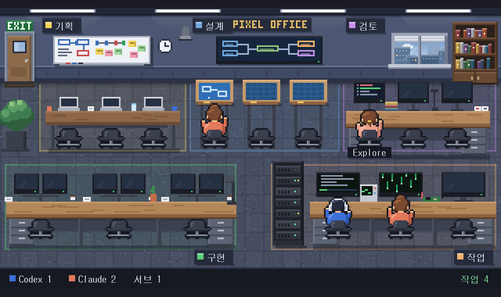

# pixel-office

Codex와 Claude Code가 일하는 모습을 2D 픽셀 사무실로 실시간으로 보여 준다. VS Code에서는 편집기 옆 탭에, Orca에서는 내장 브라우저 탭에 같은 화면이 뜬다.



- 작업 폴더(VS Code 워크스페이스, Orca worktree)마다 사무실이 하나다. 다른 폴더의 에이전트는 섞이지 않는다.
- 에이전트 세션마다 직원 1명, Claude Code 서브에이전트마다 인턴 1명이 나온다(최대 12명, 넘으면 "+N").
- 직원은 지금 하는 일에 맞는 구역으로 걸어서 옮긴다.

| 구역 | 들어가는 일 |
|---|---|
| 기획 | 지시를 막 받음, 계획 모드, 할 일 목록, 사용자에게 질문, 서브에이전트에게 일 넘기기 |
| 설계 | 문서 편집(`.md` 등, `docs/` 같은 폴더) |
| 구현 | 그 밖의 코드 편집 |
| 작업 | 명령 실행과 테스트 |
| 검토 | 파일 읽기와 검색, 웹 조회, `git diff` 같은 읽기 전용 명령 |

| 상태 | 화면 |
|---|---|
| 작업 중 | 자리에서 타이핑, 화면이 켜짐 |
| 응답 대기(권한 요청 등) | 손을 들고 "?" 말풍선 |
| 문제 발생(명령 실패, API 오류) | 머리를 감싸고 빨간 "!" |
| 완료 | 만세, 4초 뒤 쉬는 중 |
| 쉬는 중 | 의자에 기대 앉음 |

상태는 에이전트가 내보내는 훅 신호로 정한다. 화면 글자나 편집 패턴으로 짐작하지 않는다. 구역만은 도구 이름으로 추정한다([한계](#한계) 참고).

## 설치 (새 PC나 노트북)

Node.js 20 이상과 git이 필요하다. 아직 npm이나 마켓플레이스에 올리지 않았으므로 저장소를 받아서 빌드한다.

```bash
git clone https://github.com/kimcheolhui9846/pixel-office.git
cd pixel-office
npm install
npm run build
npx pixel-office init     # Claude Code와 Codex에 훅을 넣는다. diff를 보여 주고 확인을 받는다
npx pixel-office doctor   # 빌드, 서버, 훅 상태를 점검한다
```

Windows에서는 PowerShell에서 같은 명령을 쓴다. WSL bash가 아니라 Windows 쪽 node로 설치해야, Windows에서 연 VS Code와 Orca가 같은 서버를 본다.

- `init` 뒤에 **Codex 안에서 `/hooks`를 열어 Pixel Office 훅을 신뢰**한다. 신뢰하기 전에는 Codex가 훅을 실행하지 않는다.
- 이미 열려 있던 Claude Code와 Codex 세션에는 훅이 들어가지 않는다. 새 세션을 연다.
- 저장소 폴더를 옮기거나 node를 바꾸면 `init`을 다시 실행한다. 다시 해야 하는지는 `doctor`가 알려 준다.

### `init`이 고치는 파일

| 에이전트 | 파일 |
|---|---|
| Claude Code | `~/.claude/settings.json` (`CLAUDE_CONFIG_DIR`이 있으면 그 폴더) |
| Codex | `~/.codex/hooks.json` (`CODEX_HOME`이 있으면 그 폴더). 폴더가 없으면 건너뛴다. Windows에서는 `~/.pixel-office/pixel-office-codex-hook.cmd` 래퍼도 쓴다 |

- 고치기 전에 diff를 보여 주고, "적용할까요? (y/N)"에 답을 받은 뒤, 원래 파일을 `~/.pixel-office/backups/<시각>/`에 백업한다.
- 다른 훅(Orca, skill kit 등)과 다른 설정은 그대로 둔다. Pixel Office 훅만 더하거나 바꾼다.
- `--dry-run`은 diff만 보여 준다. `--yes`는 묻지 않는다. `--agent claude|codex`는 한쪽만 고친다.
- 터미널이 아닌 곳에서 `--yes` 없이 실행하면 아무것도 쓰지 않고 종료 코드 64로 끝난다.
- 되돌리기: `npx pixel-office uninit`은 Pixel Office 훅만 지운다.

## VS Code에서 쓰기

VS Code 창을 폴더와 함께 열면 그 폴더의 사무실이 편집기 옆 탭에 자동으로 열린다. 서버가 없으면 확장이 띄운다. 서버는 창을 닫아도 남는다.

저장소에서 `.vsix`를 만들어 VS Code에 한 번 설치한다(패키징에는 Node 22 이상이 필요하다).

```bash
npm run build
npm run package -w packages/vscode                                # packages/vscode/pixel-office-0.0.1.vsix
code --install-extension packages/vscode/pixel-office-0.0.1.vsix
```

- vsix 안에 서버와 화면이 들어 있어서, 설치한 뒤에는 저장소가 없어도 사무실이 뜬다. 에이전트 훅(`init`)은 저장소의 것을 쓰므로 저장소는 지우지 않는다.
- 업데이트하면 vsix를 다시 만들어 같은 명령으로 설치한다.
- 설치하지 않고 개발 창으로 실행하려면 `code --extensionDevelopmentPath=<저장소>/packages/vscode <작업 폴더>`를 쓴다.

- 명령 팔레트의 "Pixel Office: 사무실 열기"로 다시 연다.
- 설정 `pixelOffice.autoOpen`을 끄면 자동으로 열지 않는다.
- 탭을 숨기면 그리기를 멈추고, 다시 보이면 새로 그린다.

## Orca에서 쓰기

Orca 터미널에서 Claude Code나 Codex에게 일을 시키면, 에이전트 훅이 그 worktree의 사무실 탭을 Orca 브라우저에 연다. 이미 열려 있으면 그대로 두고, 서버가 없으면 띄운다.

1. Orca 밖 터미널에서 `npx pixel-office init`을 실행한다.
2. **Orca를 완전히 끄고 다시 연다.** Orca는 시작할 때 사용자 설정을 자기 프로필로 복사한다. 그래서 init 뒤에 Orca를 다시 시작해야 Orca 안의 에이전트에 훅이 들어간다.
3. Orca 안의 Codex에서 `/hooks`로 Pixel Office 훅을 신뢰한다. Orca의 Codex는 계정 폴더가 따로라서, Orca 밖에서 한 신뢰와 별개다.
4. Orca 터미널에서 `npx pixel-office doctor`를 실행하면 Orca가 쓰는 설정 사본을 점검한다.

```bash
npx pixel-office orca-open   # Orca 터미널에서 직접 열기
```

`PIXEL_OFFICE_ORCA_OPEN=0`이면 자동으로 열지 않는다. 같은 worktree는 60초에 한 번만 확인한다.

## 브라우저에서 보기

```bash
npx pixel-office start   # 서버를 포그라운드로 실행 (기본 포트 47821, Ctrl+C로 종료)
npx pixel-office url     # 현재 폴더의 사무실 주소, 예: http://127.0.0.1:47821/?workspace=D:/work/repo
```

`?workspace` 없이 열면 모든 폴더의 에이전트를 합쳐서 보여 준다. `C:\...`, `c:/...`, WSL의 `/mnt/c/...`는 같은 폴더로 본다.

## 명령

| 명령 | 하는 일 |
|---|---|
| `start [--port N]` | 서버 실행 |
| `url [폴더]` | 그 폴더의 사무실 주소 출력 |
| `init` / `uninit` | 훅 넣기 / 빼기 (`--dry-run`, `--yes`, `--agent`, WSL에서는 `--windows-home`) |
| `doctor` | Node 버전, 빌드, 서버, 훅, Codex 래퍼, 작업 폴더, Orca 여부를 점검한다. 아무것도 고치지 않고 토큰을 출력하지 않는다. 문제가 있으면 종료 코드 1 |
| `orca-open` | Orca worktree의 사무실 탭 열기 |
| `simulate [--loops N] [--speed X]` | 실행 중인 서버에 데모 이벤트 보내기 |

저장소 폴더에서는 `npx pixel-office ...`로 실행한다. 다른 폴더에서는 `node <저장소>/packages/cli/dist/src/cli.js ...`를 쓴다.

| 환경 변수 | 뜻 |
|---|---|
| `PIXEL_OFFICE_HOME` | `server.json`, 백업, Codex 래퍼를 둘 폴더 (기본 `~/.pixel-office`). Windows에서 이 경로에 공백이 있으면 Codex 훅을 넣을 수 없으니 공백 없는 폴더를 지정한다 |
| `CLAUDE_CONFIG_DIR`, `CODEX_HOME` | 에이전트 설정 폴더 |
| `PIXEL_OFFICE_ORCA_OPEN=0` | Orca 탭 자동 열기 끄기 |

## 업데이트

```bash
git pull
npm install
npm run build
npx pixel-office doctor   # 새 훅 이벤트가 생겼으면 init을 다시 하라고 알려 준다
```

서버가 이미 떠 있으면 옛 코드로 돈다. 서버 프로세스를 끄면 다음에 VS Code나 Orca 훅이 새 코드로 띄운다.

## 한계

**훅 신호로 정하는 것**
- 작업 중, 응답 대기, 문제 발생, 완료.
- 서브에이전트의 시작과 끝(Claude Code `SubagentStart`, `SubagentStop`).

**추정하는 것**
- **구역.** 에이전트가 부른 도구 이름, 파일 확장자와 폴더 이름, 명령의 첫 단어로 정한다. 예를 들어 `python script.py`는 읽기만 해도 "작업"이고, 확장자 없는 문서는 "구현"이다. MCP 도구처럼 모르는 도구는 구역을 바꾸지 않는다.
- **쉬는 중.** 이벤트가 30초 없으면 쉬는 중으로 바꾼다. 에이전트가 오래 생각하는 중에도 쉬는 것으로 보일 수 있다.
- **Codex 명령 실패.** Codex 훅은 셸 명령의 종료 코드를 주지 않는다. 그래서 Codex에서 명령이 실패해도 "문제 발생"으로 보이지 않는다. API 오류는 보인다.

**지원하지 않거나 확인하지 못한 것**
- Codex 서브에이전트. 훅에서 신호를 찾지 못했다. Codex 본 세션은 나온다.
- Codex 도구 이름은 실제 훅에서 `Bash`만 확인했다. `apply_patch`, `update_plan` 등은 문서를 보고 넣었다.
- 마켓플레이스 배포, VS Code 원격(WSL, SSH) 창.
- WSL 안에서 돌린 에이전트. 코드와 테스트는 있지만 실제 WSL에서 돌려 보지 않았다. WSL은 mirrored networking이어야 한다.
- 9c단계의 새 사무실 화면은 웹 브라우저와 VS Code(vsix 설치)에서 확인했다. Orca 탭은 그 전 화면으로 확인했다.
- Claude Code 훅은 백그라운드로 돌아서 이벤트 순서가 가끔 바뀔 수 있다. 화면에 드러나는 경우는 보지 못했다.

자세한 근거와 확인 날짜는 `docs/DESIGN.md`에 있다.

## 완료 기준 점검

2026-11-09, Windows 11, Node 24, Orca 1.4.253, VS Code 1.145.2, codex-cli 0.167.0 기준.

| 기준 | 결과 | 근거 |
|---|---|---|
| VS Code와 Orca 양쪽에서 같은 UI가 뜨고 상태가 갱신된다 | 충족 (Orca는 9c 이전 화면으로 확인) | `docs/screenshots/step10-vscode-vsix.png`(vsix로 설치한 VS Code, 9c 화면), `step7-vscode-webview.png`, `step8-orca-auto-tab.png`. DESIGN 10.3, 11.3, 14.3 |
| Claude Code 상태가 훅 신호만으로 전환된다 | 충족 | 실제 세션 캡처 `step4-real-*.png`, `step9c-live-subagent.png`. DESIGN 7절 |
| 훅/서버 장애가 에이전트 작업을 막지 않는다 | 충족 | 훅은 0.5초 안에 출력 없이 끝나고 항상 종료 코드 0이다. Claude 훅은 백그라운드로 돈다. 서버가 없을 때 약 70ms, 응답 없는 서버에서 약 580ms(동기로 도는 Codex 훅은 이만큼 기다린다). DESIGN 7.3 |
| 서로 다른 worktree의 세션이 섞이지 않는다 | 충족 | `step6-workspace-*.png`. DESIGN 9.3 |
| 상태 머신 단위 테스트 통과, `simulate`로 5개 상태 시각 확인 | 충족 | 테스트 329개 통과(core 190, ui 48, cli 84, vscode 7). 장면 캡처 `step9c-*.png` |
| 유휴 시 CPU가 낮다 | 충족 | 아래 표 |
| 외부 저작권 에셋 없음, 사용자 설정은 백업 후 병합만 | 충족 | 모든 그림은 코드 안의 픽셀 데이터다. `init`은 diff, 확인, 백업 뒤 Pixel Office 훅만 더한다 |

### CPU

측정 방법: Playwright Chromium(1280×760)에서 CDP `Performance.getMetrics`의 TaskDuration 증가분을 실제 시간으로 나눴다. 서버 프로세스는 이벤트가 없을 때 0%였다.

| 화면 | 시간 | CPU |
|---|---|---|
| 사람 없는 사무실 | 30초 | 0.175% |
| 쉬는 사람 3명 | 20초 | 0.185% |
| 데모(걷기 포함) | 20초 | 0.529% |

기본은 초당 10번 그리고, 그림이 바뀔 때만 다시 칠한다. 누군가 걷는 동안만 초당 20번이다. 시스템에서 움직임 줄이기(`prefers-reduced-motion`)를 켜면 타이핑 같은 반복 동작을 멈춘다.

## 보안

- 서버는 `127.0.0.1`에만 열린다. 이벤트는 `server.json`의 토큰이 있어야 받고, 다른 출처(Origin)의 접속은 거절한다.
- 훅이 서버로 보내는 것은 에이전트 종류, 세션 id, 작업 폴더 경로, 상태, 도구 이름, 구역 이름, 서브에이전트 종류뿐이다. 파일 내용, 명령, 프롬프트, 응답은 보내지 않는다.
- 자세한 내용은 `docs/DESIGN.md` 6절에 있다.

## 개발

```bash
npm install
npm run build
npm test
npm run typecheck
```

에이전트 없이 데모 화면 보기:

```bash
npm run build
python -m http.server 47918 --bind 127.0.0.1 --directory packages/ui/dist/web
```

브라우저에서 `http://127.0.0.1:47918/?demo`를 연다. `?demo=6000`은 6초 시점에 멈춘다. 서버로 데모를 보내려면 `npx pixel-office start`를 띄우고 다른 터미널에서 `npx pixel-office simulate`를 실행한다.

패키지: `packages/core`(상태 머신, 훅 변환, 서버), `packages/ui`(캔버스 화면), `packages/cli`(명령과 훅), `packages/vscode`(VS Code 확장). 설계와 단계별 확인 기록은 `docs/DESIGN.md`에 있다.

라이선스는 MIT다.
